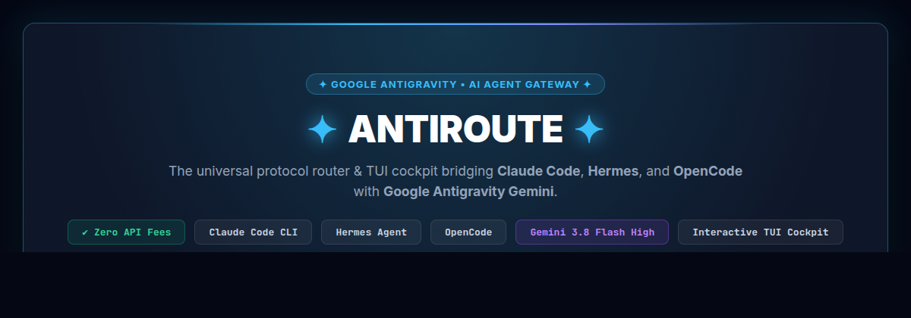
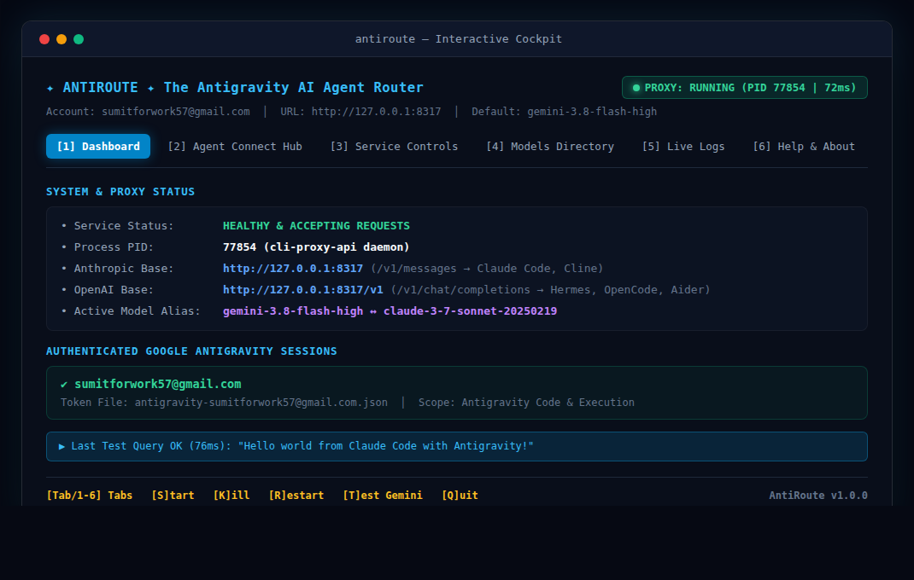
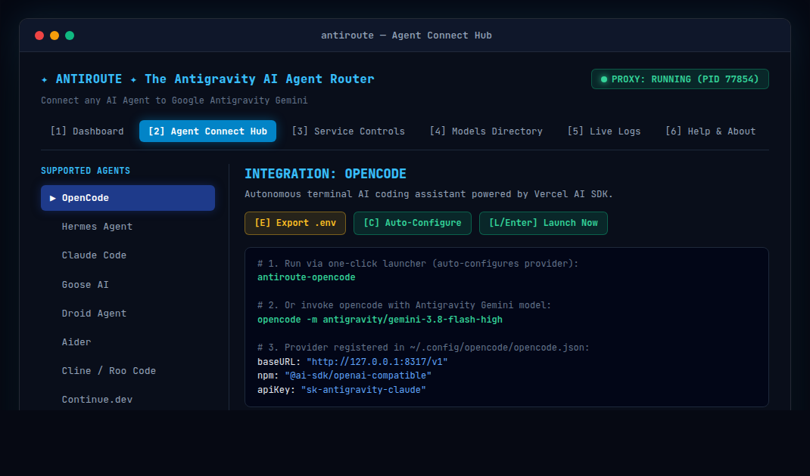
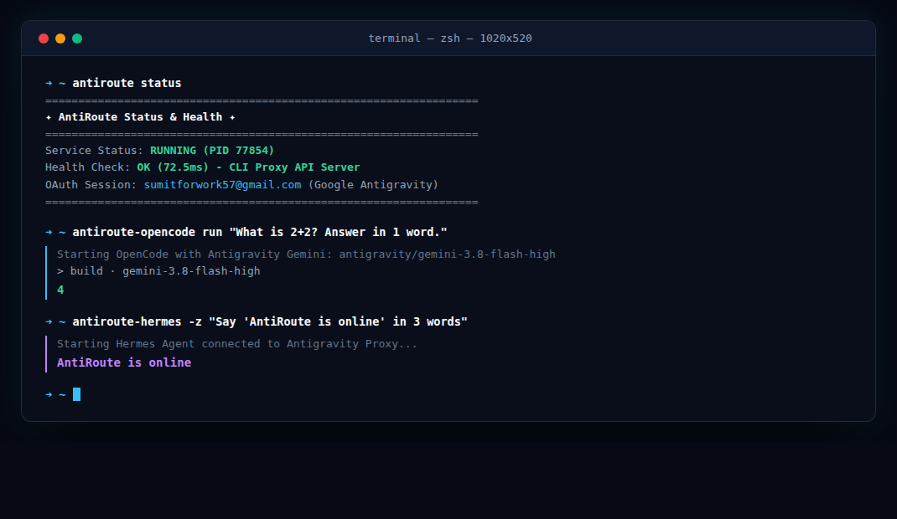

<p align="center">
  
</p>

<p align="center">
  <a href="https://github.com/Sumit4codes/antiroute/stargazers"></a>
  <a href="https://github.com/Sumit4codes/antiroute/blob/main/LICENSE"></a>
  <a href="https://github.com/Sumit4codes/antiroute/releases"></a>
  <a href="https://github.com/Sumit4codes/antiroute/issues"></a>
</p>

<p align="center">
  <strong>The open-source multi-protocol gateway & interactive TUI cockpit.</strong><br>
  <em>Route Claude Code, Hermes, OpenCode, Aider, and Goose into Google Antigravity Gemini with zero API costs.</em>
</p>

<p align="center">
  <a href="#-quickstart">Quickstart</a> &bull;
  <a href="#-interactive-tui-cockpit">TUI Cockpit</a> &bull;
  <a href="#-supported-agents">Supported Agents</a> &bull;
  <a href="#-architecture">Architecture</a> &bull;
  <a href="#-cli-reference">CLI Reference</a> &bull;
  <a href="#-background-daemon-systemd">Daemon</a>
</p>

---

## ✦ Why AntiRoute?

Modern AI developer agents like **Claude Code**, **Hermes**, and **OpenCode** are powerful, but enterprise token costs accumulate quickly. **Google Antigravity** provides quota for state-of-the-art Gemini models (**Gemini 3.8 Flash High**, **Gemini 3.1 Pro Preview**), but coding agents expect Anthropic or OpenAI API schemas.

**AntiRoute bridges this divide:**
* ⚡ **Zero API Fees**: Routes agent tasks through your Google Antigravity OAuth session.
* 🔄 **Bi-Directional Translation**: Speaks both Anthropic Messages API (`/v1/messages`) and OpenAI API (`/v1/chat/completions`).
* 🖥️ **Interactive Terminal Cockpit**: Manage daemon lifecycle, inspect live latency, browse models, and tail logs.
* 🚀 **One-Click Agent Connectors**: Pre-configured launchers and automatic `.config/opencode/opencode.json` generation.
* 📦 **Zero-Friction CLI**: Instant installation to `~/.local/bin` with automatic symlink resolution.

---

## 📸 Screenshots & Showcase

### 1. Interactive TUI Cockpit (`antiroute`)
Full process supervision, real-time health checks, latency tracking, and Google Antigravity OAuth token status:

<p align="center">
  
</p>

---

### 2. Agent Connect Hub
One-click integration for Hermes, OpenCode, Claude Code, Aider, Goose, Droid, and Cline with instant `.env` exports:

<p align="center">
  
</p>

---

### 3. Live Agent Execution
Directly running autonomous agent tasks via AntiRoute:

<p align="center">
  
</p>

---

## ⚡ Quickstart

Get up and running in under 60 seconds:

### Step 1: Clone Repository
```bash
git clone https://github.com/Sumit4codes/antiroute.git
cd antiroute
```

### Step 2: Authenticate Antigravity OAuth
Authenticate your Google account (credentials are stored securely in local `.auth/`):
```bash
./login-antigravity.sh
# If on SSH or a headless server without a desktop browser:
./login-antigravity.sh --no-browser
```

### Step 3: Install CLI Shortcuts
```bash
./install.sh
```
*This installs `antiroute`, `antiroute-hermes`, `antiroute-opencode`, and `antiroute-claude` globally into `~/.local/bin`.*

### Step 4: Launch the Cockpit
```bash
antiroute
```

---

## 🤖 Supported Agents

AntiRoute translates requests on `http://127.0.0.1:8317`. Choose your preferred agent below:

| Agent | Protocol | One-Click Launcher | Manual Command |
|---|---|---|---|
| **OpenCode** | OpenAI / Anthropic | `antiroute-opencode` | `opencode -m antigravity/gemini-3.8-flash-high` |
| **Hermes Agent** | OpenAI | `antiroute-hermes` | `export OPENAI_BASE_URL="http://127.0.0.1:8317/v1" && hermes` |
| **Claude Code CLI** | Anthropic | `antiroute-claude` | `export ANTHROPIC_BASE_URL="http://127.0.0.1:8317" && claude` |
| **Aider** | OpenAI | `./export-env.sh aider` | `aider --openai-api-base http://127.0.0.1:8317/v1` |
| **Goose AI** | OpenAI | `./export-env.sh goose` | `export GOOSE_PROVIDER=openai && goose session` |
| **Cline / Roo Code** | OpenAI / Anthropic | *VS Code Settings* | Base URL: `http://127.0.0.1:8317/v1` |
| **Continue.dev** | OpenAI | *config.json* | `"apiBase": "http://127.0.0.1:8317/v1"` |

<details>
<summary><strong>🔍 Click to view manual configuration snippets for each agent</strong></summary>

### OpenCode Setup
OpenCode is automatically configured by AntiRoute. To verify or manually add it, ensure your `~/.config/opencode/opencode.json` contains:
```json
{
  "provider": {
    "antigravity": {
      "name": "Antigravity Gemini",
      "npm": "@ai-sdk/openai-compatible",
      "options": {
        "apiKey": "sk-antigravity-claude",
        "baseURL": "http://127.0.0.1:8317/v1"
      },
      "models": {
        "gemini-3.8-flash-high": { "name": "Gemini 3.8 Flash High" },
        "gemini-3.1-pro-preview": { "name": "Gemini 3.1 Pro Preview" }
      }
    }
  }
}
```

### Hermes Agent Setup
```bash
source ./export-env.sh hermes
hermes --model gemini-3.8-flash-high
```

### Claude Code Setup
```bash
export ANTHROPIC_BASE_URL="http://127.0.0.1:8317"
export ANTHROPIC_API_KEY="sk-antigravity-claude"
claude
```

### Cline & Roo Code (VS Code Extension)
* **Provider**: OpenAI Compatible
* **Base URL**: `http://127.0.0.1:8317/v1`
* **API Key**: `sk-antigravity-claude`
* **Model ID**: `gemini-3.8-flash-high`

### Python SDK / LangChain / CrewAI
```python
from openai import OpenAI

client = OpenAI(
    base_url="http://127.0.0.1:8317/v1",
    api_key="sk-antigravity-claude"
)

response = client.chat.completions.create(
    model="gemini-3.8-flash-high",
    messages=[{"role": "user", "content": "Explain quantum entanglement in 2 sentences."}]
)
print(response.choices[0].message.content)
```

</details>

---

## 🛠️ Interactive TUI Controls

Run `antiroute` to enter the interactive terminal cockpit:

| Tab | Key | Description |
|---|---|---|
| **Dashboard** | `[1]` | Real-time proxy health, active PID, latency (ms), and OAuth account status |
| **Agent Hub** | `[2]` | Agent directory, `.env` exporter (`[E]`), auto-config (`[C]`), launcher (`[Enter]`) |
| **Controls** | `[3]` | Start, stop, restart daemon, run diagnostic queries, or re-authenticate OAuth |
| **Models** | `[4]` | Live model catalog from `/v1/models`. Press `[T]` to test, `[D]` to set as default backend |
| **Live Logs** | `[5]` | Real-time scrollable log viewer with syntax color coding |
| **Help** | `[6]` | Keybinding cheat sheet and CLI examples |

**Global Keybindings:**
* `[Tab]` / `[1-6]`: Switch tabs
* `[S]`: Start proxy daemon
* `[K]`: Kill / Stop proxy daemon
* `[R]`: Restart proxy daemon
* `[T]`: Run instant test query against Gemini
* `[Q]`: Exit TUI cockpit

---

## 💻 CLI Reference (Non-Interactive)

`antiroute` functions as a scriptable command-line tool in automated pipelines:

```bash
# Check service health and active OAuth account
antiroute status

# Test both Anthropic and OpenAI endpoints
antiroute test

# List connection commands for all agents
antiroute connect

# Get connection snippet for a specific tool
antiroute connect hermes
antiroute connect opencode

# Export environment file (.env.hermes, .env.opencode)
antiroute connect hermes --export
antiroute connect opencode --export

# Process supervision
antiroute start
antiroute stop
antiroute restart
```

---

## 🏗️ Architecture

```
┌────────────────────────────────────────────────────────┐
│  AI Coding Agents: Claude Code / Hermes / OpenCode...  │
└───────────────────────────┬────────────────────────────┘
                            │ Anthropic (/v1/messages)
                            │ or OpenAI (/v1/chat/completions)
                            ▼
┌────────────────────────────────────────────────────────┐
│                  AntiRoute (Port 8317)                 │
│         Translates schemas to Gemini protocols         │
└───────────────────────────┬────────────────────────────┘
                            │ Antigravity OAuth Tokens (.auth/)
                            ▼
┌────────────────────────────────────────────────────────┐
│                  Google Antigravity                    │
│      Gemini 3.8 Flash High / Gemini 3.1 Pro Models     │
└────────────────────────────────────────────────────────┘
```

---

## ⚙️ Background Daemon (systemd)

To run AntiRoute as an automatic background service that starts on boot:

```bash
# Install user service
./setup-systemd.sh install

# Enable on boot
systemctl --user enable antiroute

# Start daemon
systemctl --user start antiroute

# Inspect status
systemctl --user status antiroute

# Stop daemon
systemctl --user stop antiroute
```

---

## 🔒 Security & Privacy

* **Local Token Storage**: All OAuth tokens are saved in `.auth/` with strict permissions.
* **Git Safe**: The repository includes a hardened `.gitignore` ensuring credentials, `.env` files, PID locks, and session logs are never staged or pushed.
* **Zero Telemetry**: AntiRoute does not transmit your prompts, tokens, or queries to third-party tracking servers.

---

## 🤝 Contributing

Contributions, bug reports, and agent profile requests are welcome!
1. Fork the Project (`https://github.com/Sumit4codes/antiroute/fork`)
2. Create your Feature Branch (`git checkout -b feature/NewAgentIntegration`)
3. Commit your Changes (`git commit -m 'Add support for NewAgent'`)
4. Push to the Branch (`git push origin feature/NewAgentIntegration`)
5. Open a Pull Request

---

## 📄 License

Distributed under the **MIT License**. See [`LICENSE`](LICENSE) for more information.

<p align="center">
  Built with ✦ by <a href="https://github.com/Sumit4codes">Sumit Yadav</a>
</p>
